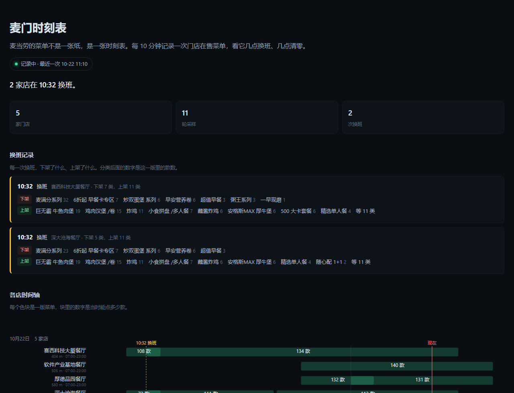

# 麦门时刻表

**麦当劳的菜单不是一张纸，是一张时刻表。**

这个项目用麦当劳中国 MCP 每 10 分钟记录一次门店的在售菜单，连续跑三天，把「早餐什么时候消失、正餐什么时候上架、几点整店清零」画成时间轴。

👉 **在线看图：https://lbdggls.github.io/mcd-timetable/**

> 页面里是深圳南山深大南附近 5 家店的真实数据，**只是示例**。这是个工具，换城市只要改一行配置。

<p align="center"></p>

## 为什么要做这个

所有点餐助手都只截「这一刻」的菜单。但菜单是活的。

实测抓到的一次换班，同一家店，相隔 3 分钟：

```
10:29                          10:32
超值早餐        (3)  ┐
6折起早餐卡专区  (7)  │
麦满分系列     (32)  ├─ 全部下架
炒双蛋堡系列     (6)  │
早安营养卷       (6)  │
一早现磨         (1)  │
粥王系列         (3)  ┘
                              ┌─ 鸡肉汉堡/卷 (15)
                              ├─ 巨无霸 牛鱼肉堡 (19)
                              ├─ 炸鸡 (11)
                              ├─ 安格斯MAX 厚牛堡 (6)
                              ├─ 随心配 1+1 (2)
                              ├─ 小食拼盘/多人餐 (7)
                              ├─ 开心乐园 (4)
                              └─ 500 大卡套餐 (6) …
餐品总数  108           →      134
```

你 10:31 走进店里，看到的和 10:29 是两个世界。这件事没人记录过——因为它需要「等」，而抓一次快照的工具有很多。

所以这个项目的产品不是算法，是**时间**。

## 页面能看什么

主体是**换班记录**：每一次换班，下架了什么、上架了什么，各多少款。

```
10:32  换班   赛西科技大厦餐厅 · 下架 7 类，上架 11 类
  下架  麦满分系列 32 · 早餐卡专区 7 · 炒双蛋堡 6 · 早安营养卷 6
        超值早餐 3 · 粥王系列 3 · 一早现磨 1
  上架  巨无霸牛鱼肉堡 19 · 鸡肉汉堡/卷 15 · 炸鸡 11 · 小食拼盘 7
        蘸酱炸鸡 6 · 安格斯 6 · 500 大卡套餐 6 · 精选单人餐 4 等 11 类
```

往下依次是：

- **各店时间轴**：一行一家店，色块是一版菜单，块里的数字是当时能点多少款
- **此刻各店**：现在几点、在售多少款、还有多久关门
- **细节**：每家店每个分类的出现区间，折叠起来

顺带一个发现：同一个区域、同一天，5 家店的在售款数并不一样（134 / 140 / 132 / 113 / 124），换班下架的类目数也不同。

## 怎么做的

```
Windows 计划任务（每 10 分钟）
        │
        ├─ collect.py
        │    ├─ query-meals            每家店 1 次，拿到分类和餐品编码
        │    ├─ query-meal-detail      只给"没见过的编码"补名称（有本地缓存）
        │    └─ 追加一行 JSONL 到 data/samples.jsonl
        │
        └─ render_html.py
             └─ 读 JSONL → 生成静态 index.html（内联 SVG，无框架）
```

采样和渲染由 Windows 计划任务每 10 分钟触发一次，另有一个每 30 分钟的任务把最新数据和页面推到 GitHub。

两个关键设计：

**名称缓存。**稳态下每轮采样只有 2 次接口调用。只有菜单换班、新品上架时才补 `query-meal-detail`，三天下来累计不到 300 次。

**数据即源码。**`data/samples.jsonl` 直接提交进仓库，任何人都能拿它重新渲染页面、自己做分析。页面不需要 Token——访客点开就能看。

## 用了哪些 MCP 工具

| Tool | 用途 |
|---|---|
| `now-time-info` | 采样打时间戳、判断门店是否还在营业 |
| `query-nearby-stores` | 按城市+关键词定位门店（深大南） |
| `query-meals` | **核心**：每轮采样拉一次在售分类与餐品编码 |
| `query-meal-detail` | 编码换名称，仅对新出现的餐品调用 |

详细调用顺序、参数细节和踩到的坑见 [MCP_INTEGRATION.md](./MCP_INTEGRATION.md)。

## 跑自己的店

不用改代码。仓库根目录的 `config.json` 就是这台实例的全部配置：

```json
{
  "city": "深圳",
  "keyword": "深大南",
  "stores": ["1420944", "1421217"],
  "max_stores": 2,
  "data_dir": "data"
}
```

- `stores` 留空 `[]` 时，按 `city` + `keyword` 自动搜最近的 `max_stores` 家，门店编码和营业时间由 `query-nearby-stores` 自动解析，你不需要知道任何编码。
- 想同时跑两个城市，用不同的数据目录，互不干扰：`--data-dir data-chengdu`。

```bash
export MCD_MCP_TOKEN='你的 Token'   # https://open.mcd.cn/mcp 手机号登录 → 控制台 → 激活

python collect.py                      # 采一次（读 config.json）
python collect.py --city 成都 --keyword 春熙路 --max-stores 3   # 或者临时换地方
python render_html.py                  # 生成 index.html，双击就能看
```

想让它自己跑，Windows 用计划任务、Linux 用 crontab，每 10 分钟调一次 `collect.py`：

```bash
*/10 * * * * cd /path/to/mcd-timetable && python collect.py && python render_html.py
```

零第三方依赖，Python 3.9+。仓库里的 `data/` 是深圳这份实例的真实数据，你可以整个删掉换成自己的；`docs/preview.png` 同理。

## 已知边界

- 目前只采了深圳南山两家店：赛西科技大厦（23:00 关）和深大沧海（22:00 关），关店时间不同是为了对比
- 采样间隔 10 分钟，换班时刻记为第一次观测到新菜单的采样点，真实切换发生在这 10 分钟之间
- 门店打烊后接口仍可能返回菜单，页面上这类色块会降透明度并标注，不会当成在营业
- 依赖本机不休眠；断了的时段页面上会显示为缺口，不做填补
- 餐品供应、价格以门店当时实际为准；本项目为参赛作品，非麦当劳官方产品

## License

MIT。参赛声明见 [CONTEST_DECLARATION.md](./CONTEST_DECLARATION.md)。
